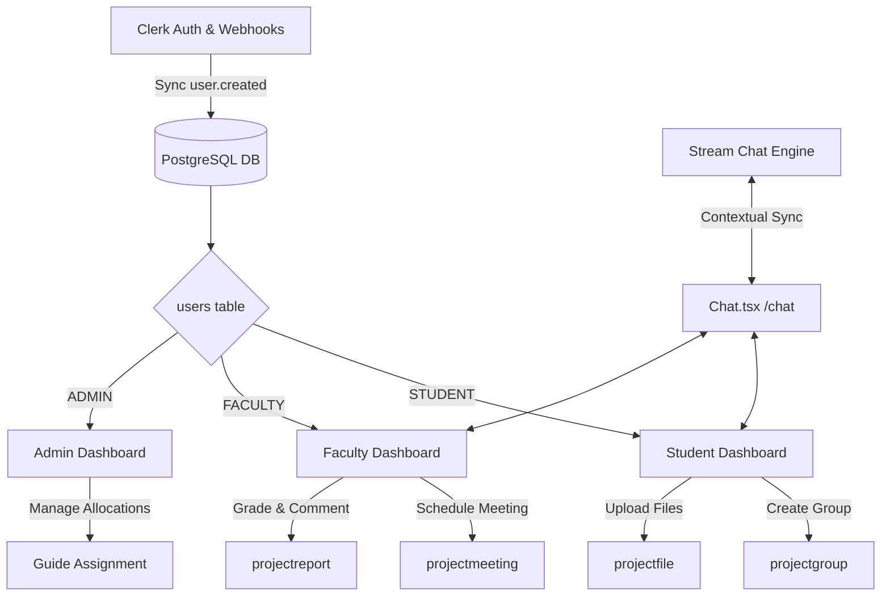

# 🛡️ Projexia: Student Project Management System (SPMS) Hub

Welcome to **Projexia (SPMS Project Hub)**, a state-of-the-art, full-stack Academic Project Management platform designed to streamline, track, and elevate the entire lifecycle of student projects. From team formation to final evaluations, Projexia brings students, faculty mentors, and administrators into a cohesive, high-performance digital workspace.

---

## 🚀 What It Does

Academic projects often suffer from fragmented communication, manual guide allocation, chaotic file tracking, and disjointed scheduling. **Projexia** addresses these pain points by offering a centralized hub that manages the three pillars of academic projects: **Structure, Progress, and Communication**.

### 🌟 Core Capabilities
1. **Multi-Role Workspace (RBAC)**: Personalized, feature-rich dashboards for **Students**, **Faculty Mentors**, and **Administrators**, powered by secure Clerk Authentication.
2. **Dynamic Project Lifecycle Management**: Structured stages from registration, group formation, project proposal submission, and review approvals.
3. **Smart Allocation System**: Structured matchmaking between student project themes and faculty expertise (Guide, Convener, and Expert allocations).
4. **Comprehensive Progress Tracking**: Automated milestone tracking, file submission version control, and graded faculty reviews (Proposals, Midterms, Finals).
5. **WhatsApp-Style Real-time Chat**: Fully integrated instant messaging using the Stream Chat engine, contextually linking groups to their assigned guides.
6. **Milestone Meeting Manager**: Faculty can schedule progress reviews, mark interactive student attendance, record review notes, and assign grades.

---

## 🎨 Technical Architecture



### 💻 Modern Tech Stack
- **Framework**: Next.js 15+ (App Router) for highly performant Server Components and seamless Client Hydration.
- **Styling & UI**: Tailwind CSS with beautifully integrated Framer Motion micro-animations.
- **Database ORM**: Prisma Client mapped to a robust PostgreSQL relational database.
- **Identity & RBAC**: Clerk Core Security with custom JWT Claims synchronization via secure Clerk Webhooks.
- **Real-Time Communication**: Stream Chat SDK with customized dark-themed, mobile-responsive styling.

---

## 🔄 The Complete Project Workflow

```
[Student Registration] ➔ [Group Formation] ➔ [Guide/Role Assignment] 
                                                        │
[Final Evaluation] 🍕 [Progress Reviews] 🍕 [Proposal & File Uploads]
```

### 1. Registration & Authentication Workflow
- **Step 1**: The user registers on the platform via Clerk.
- **Step 2**: A secure Clerk Webhook triggers an API endpoint (`/api/webhooks/clerk`) that automatically creates a matching entry in the Postgres `users` table.
- **Step 3**: By default, new users receive the `STUDENT` role. Admins can update roles in the system, which are then synchronized back to Clerk's custom JWT metadata claims to ensure immediate role-based frontend protection.

### 2. Group Formation & Project Proposal Workflow
- **Step 1**: A Student registers a new project group (`projectgroup`), becoming the **Group Leader**.
- **Step 2**: They invite teammates (`projectgroupmember`) using their unique enrollment numbers or student profiles.
- **Step 3**: The group defines their proposed Project Title, Area of Interest, and description, then submits a formal **Project Proposal**.

### 3. Guide & Expert Allocation Workflow
- **Step 1**: **Admins** assign faculty members (`staff`) to the group in three crucial capacities:
  - **Guide Staff**: Mentors the group on a weekly basis.
  - **Convener Staff**: Monitors timelines and process compliance.
  - **Expert Staff**: Acts as an external panel reviewer for milestone evaluations.
- **Step 2**: Upon allocation, the status of the project group shifts to **Active**, unlocking file submissions and communication channels.

### 4. Continuous Progress Tracking & Meetings
- **Step 1**: The assigned **Guide Staff** schedules review meetings (`projectmeeting`) specifying purpose, date, and location.
- **Step 2**: During the meeting, the guide logs student presence/absence (`projectmeetingattendance`), adds comprehensive review notes, and assigns milestone grades.
- **Step 3**: Students can upload their work and source code (`projectfile`) directly to the group folder, maintaining full version transparency.

### 5. Milestone Reporting & Evaluation
- **Step 1**: Students submit structured reports (`projectreport`) categorized as **Proposal**, **Midterm**, or **Final**.
- **Step 2**: Faculty guides review the reports, add review feedback, and transition their status:
  - 🟡 `PENDING`: Under review.
  - 🟢 `ACCEPTED`: Milestone cleared successfully.
  - 🔴 `DECLINED`: Requires revisions based on comments.

### 6. Dynamic Team Communication (Chat Hub)
- **Step 1**: The team and their allocated faculty mentor are synchronized into a private messaging channel on the **Stream Chat Engine**.
- **Step 2**: They utilize the custom, premium dark-themed Communication Hub (`/chat`) to chat, share assets, and schedule informal check-ins right inside the app.

---

## 📊 Database Schema Blueprint

Below is an overview of the PostgreSQL relational tables configured in [schema.prisma](file:///d:/CollageProject/AWT/Student_Project/SPMSMSMSMSMMSMSMSMSM/spms_project_hub/prisma/schema.prisma):

| Model Name | Primary Key | Key Fields & Purpose |
| :--- | :--- | :--- |
| **`users`** | `userid` | clerkid (unique), email, name, role (`ADMIN`, `FACULTY`, `STUDENT`) |
| **`student`** | `studentid` | enrollment (unique), phone, email, linked to a specific user record |
| **`staff`** | `staffid` | staffname, phone, email, linked to a specific user record |
| **`projectgroup`** | `projectgroupid` | projectgroupname, projecttitle, projectprogress, status, guide/convener/expert FKs |
| **`projectgroupmember`**| `projectgroupmemberid`| studentid, projectgroupid, isgroupleader (flag), studentcgpa |
| **`projectmeeting`** | `projectmeetingid` | meetingdatetime, meetingpurpose, meetinglocation, meetingnotes, meetinggrade |
| **`projectmeetingattendance`**| `projectmeetingattendanceid`| projectmeetingid, studentid, ispresent (boolean), attendanceremarks |
| **`projectfile`** | `fileid` | filename, fileurl, filetype, studentid, projectgroupid |
| **`projectreport`** | `reportid` | reporttitle, reporttype (proposal/midterm/final), status, reviewcomments |

---

## 🛠️ Installation & Setup Guide

### 1. Clone & Install Dependencies
```bash
# Install NPM packages
npm install
```

### 2. Configure Environment Variables
Create a `.env` file in the root directory:
```env
# Clerk Authentication Configuration
NEXT_PUBLIC_CLERK_PUBLISHABLE_KEY=pk_test_...
CLERK_SECRET_KEY=sk_test_...
CLERK_WEBHOOK_SECRET=whsec_...

# Database Configuration (PostgreSQL)
DATABASE_URL="postgresql://<username>:<password>@<host>:<port>/<dbname>?schema=public"

# Stream Chat API Configuration
NEXT_PUBLIC_STREAM_API_KEY=YOUR_STREAM_API_KEY
STREAM_API_SECRET=YOUR_STREAM_API_SECRET
```

### 3. Initialize the Database
```bash
# Push schema structure and run migrations
npx prisma migrate dev --name init

# Generate the type-safe Prisma client
npx prisma generate
```

### 4. Spin up Dev Server
```bash
# Run the local server
npm run dev
```
Open [http://localhost:3000](http://localhost:3000) to view your application!

---

> [!NOTE]
> Projexia is designed to scale effortlessly. Future versions plan to incorporate AI-driven teammate matchmaking based on skills/CPI and automated document analysis for plagiarism checks.
